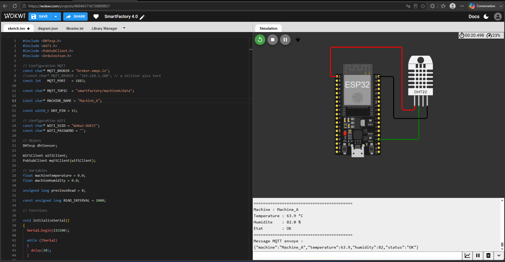
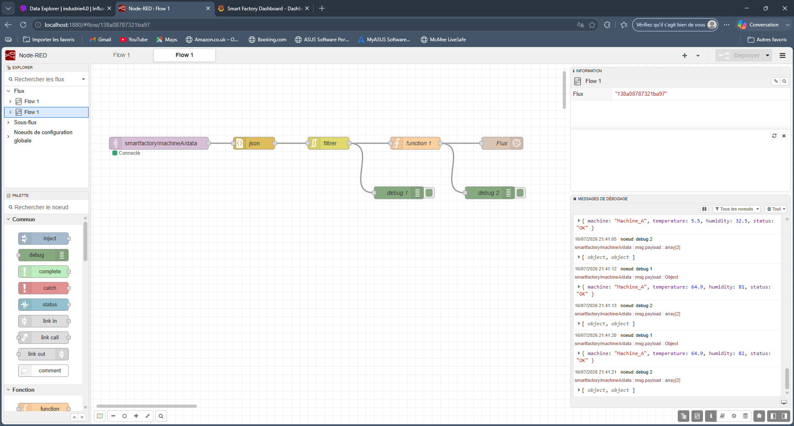
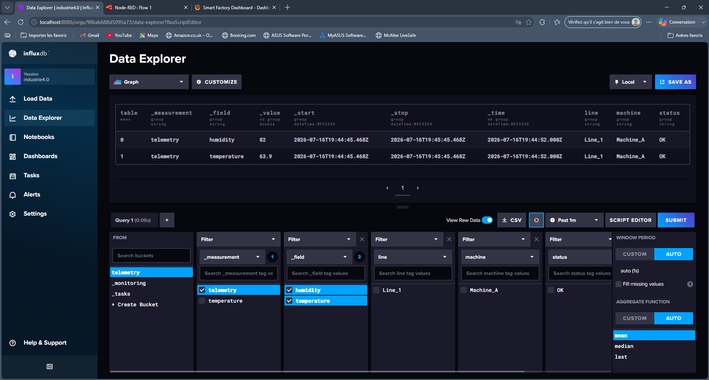
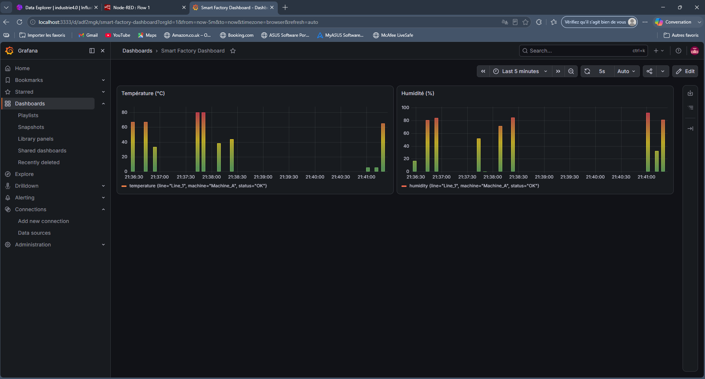

# 🏭 Smart Factory 4.0 — Learning

Premier projet IIoT (Industrial IoT) : chaîne complète de la capture d'une donnée capteur jusqu'à son affichage dans un dashboard, avec un seul capteur DHT22 pour commencer.

## Principe

```text
ESP32 (simulé sur Wokwi)
        │  Wi-Fi
        ▼
   Broker MQTT public
        │  publish / subscribe
        ▼
     Node-RED
        │
        ▼
    InfluxDB
        │
        ▼
     Grafana
```

- Un **ESP32** est simulé sur [Wokwi](https://wokwi.com) (pas de matériel physique pour cette V1), avec un capteur **DHT22** (température + humidité). Simulation à voir ici : **[https://wokwi.com/projects/468465716738809857]**
- L'ESP32 se connecte en Wi-Fi et **publie** ses mesures sur un topic MQTT, envoyées à un **broker public** sur Internet — Wokwi en version gratuite ne permet pas de se connecter à un broker local, d'où ce choix pour l'instant.
- **Node-RED** est **abonné** à ce topic : il reçoit les mesures dès qu'elles sont publiées.
- Node-RED transmet ensuite les données à **InfluxDB**, une base de données conçue pour stocker des séries temporelles (mesures horodatées).
- **Grafana** lit InfluxDB et affiche les données sous forme de graphiques.

Tout tourne dans des conteneurs **Docker** (`compose.yaml` à la racine).

## Aperçu

Exemple de relevé utilisé ci-dessous : Température = 63.9 °C, Humidité = 82 %.

**1. Simulation Wokwi (ESP32 + DHT22)**

Le circuit simulé et le code embarqué qui publie les mesures en MQTT.

**2. Node-RED**

Le flow qui s'abonne au topic MQTT et transmet les données vers InfluxDB.

**3. InfluxDB**

Les mesures stockées dans la base de données, horodatées.

**4. Grafana**

Le dashboard final, avec la température et l'humidité affichées en temps réel.

## Installation

1. Cloner le dépôt
2. Lancer la stack : `docker compose up -d`
3. Configurer InfluxDB (première utilisation uniquement) : ouvrir [http://localhost:8086](http://localhost:8086), créer le compte admin, une organisation et un bucket, puis générer un token API — c'est ce token qui permettra à Node-RED et à Grafana de s'y connecter
4. Ouvrir la simulation ESP32 sur [Wokwi](https://wokwi.com/projects/468465716738809857) et lancer la simulation
5. Importer `NodeRED/flows.json` dans Node-RED, puis renseigner l'URL d'InfluxDB, l'organisation, le bucket et le token dans le nœud de sortie InfluxDB
6. Dans Grafana, ajouter InfluxDB comme source de données (URL, organisation, bucket, token), puis importer `Grafana/SmartFactoryDashboard.json`


## Statut — V1

- [x] ESP32 (simulé, Wokwi)
- [x] MQTT (broker public)
- [x] Node-RED
- [x] InfluxDB
- [x] Grafana
- [x] Docker

## Prochaines étapes

Passage à une architecture plus proche de l'industriel : broker MQTT local (Mosquitto), ajout d'un PLC Siemens S7-1200 en OPC UA, dashboard de supervision plus complet.

## Auteur

**Yassine El Yazami** — Étudiant en Automatisation (EPHEC TECH)